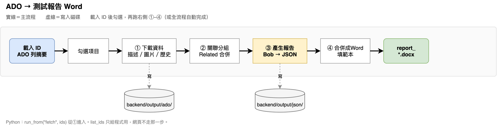

# ADO → 測試報告 Word

把 Azure DevOps 裡的 Issue 做成測試報告 Word。平常只要開網頁操作，不必寫程式。

## 使用

### 1. 啟動

用資料夾裡的啟動檔，它會檢查 Python 3.9+、Node.js 18+ 和套件，缺的會幫你裝，然後一次開好畫面。視窗請留著；要結束時按 `Ctrl+C`，前後端會一起停。

**Mac**

在 Finder 雙擊 `start-mac.command`。若提示沒有執行權限，先在終端機執行一次：

```bash
chmod +x start-mac.command
```

再雙擊，或執行：

```bash
./start-mac.command
```

如果需要輸入密碼請輸入。

**Windows**

在資料夾裡雙擊 `start-windows.bat`。

### 2. 打開畫面

安裝完成後就可以用瀏覽器開 [http://127.0.0.1:5173/](http://127.0.0.1:5173/)。

### 3. 填設定

點畫面左上角齒輪。需要：

| 欄位 | 填什麼 |
| --- | --- |
| ADO 組織 | Azure DevOps 網址裡的組織名稱 |
| ADO 專案 | 專案名稱 |
| PAT | Azure DevOps 個人存取權杖，至少要有 Work Items 讀取權限 |
| IBM Bob API Key | [申請 Inference key](https://bob.ibm.com/docs/ide/account/api-keys) |

存檔即可。這些資料只存在你電腦上的 `backend/secrets/config.json`，不要提交到 git。

### 4. 產出 Word

1. 按左上角「載入 ID」，貼上或填入要處理的 Issue。
2. 在左邊表格勾選要做成報告的項目。
3. 右邊按「全流程自動完成」（只處理勾選項目，從下載開始），或依步驟執行（下載 → 分組 → 產生報告 → 合併成 Word）。
4. 完成後，Word 在 `backend/output/`，檔名類似 `report_20260820_110000.docx`。

建議先勾 1 筆試跑，確認設定沒問題再勾多筆。

## 流程圖



## 其他說明

- [本地執行後端程式說明](docs/backend-local.md)
- [API 說明](docs/api.md)
